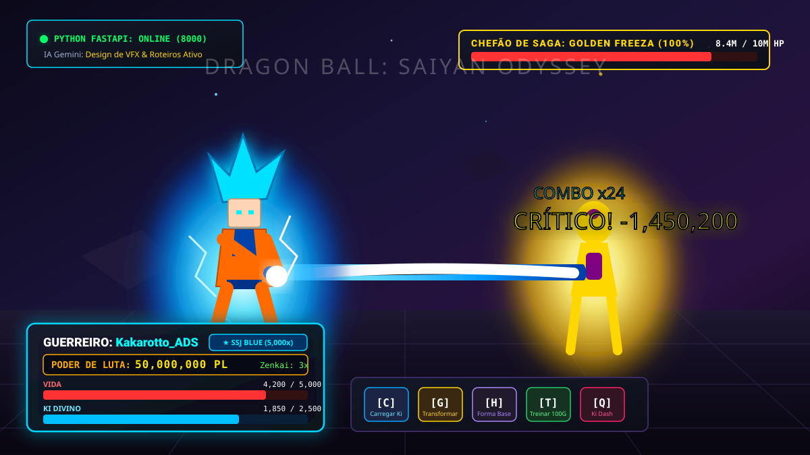
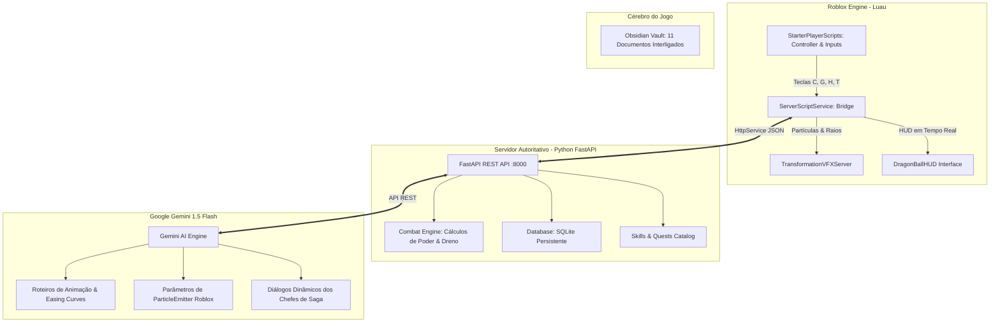

# 🐉 Dragon Ball: Saiyan Odyssey - Roblox & Python Engine

<div align="center">



[](https://python.org)
[](https://fastapi.tiangolo.com)
[](https://roblox.com)
[](https://ai.google.dev)
[](https://sqlite.org)
[](https://obsidian.md)

**Um MMORPG de Dragon Ball com arquitetura híbrida de alto nível conectando o motor 3D do Roblox (Luau) ao backend autoritativo em Python (FastAPI + SQLite), integrado à IA Google Gemini para design de animações e diálogos, e documentado com um Cérebro completo no Obsidian.**

[🎮 Simulador Terminal](#-simulador-rpg-no-terminal-python) • [⚡ Integração Roblox Studio](#-como-rodar-com-o-roblox-studio) • [🧠 Cérebro Obsidian](#-o-cérebro-do-jogo-obsidian-vault) • [🤖 IA Google Gemini](#-inteligência-artificial-google-gemini)

</div>

---

## 📸 Como o Jogo Fica no Roblox

A interface e os efeitos foram desenhados para proporcionar a sensação autêntica de combate de Dragon Ball:

* **HUD Dinâmico**: Medidor de Vida, Ki Divino e Scouter de Poder de Luta em tempo real.
* **Auras de Energia**: Partículas dedicadas com cores correspondentes a cada transformação (Dourado SSJ, Vermelho Kaioken, Magenta God, Ciano Blue, Prata UI, Púrpura Ego).
* **Raios Bioelétricos**: Faíscas crepitantes no esqueleto R15 a partir do Super Saiyajin 2.
* **Controles Rápidos**:
  * `[C]` (Segurar): Concentra energia e carrega a barra de Ki.
  * `[G]`: Ativa a forma mais poderosa desbloqueada.
  * `[H]`: Reverte instantaneamente à Forma Base para poupar energia.
  * `[T]`: Realiza ciclo de treinamento físico ou gravidade.
  * `[Q]`: Ki Dash para esquiva e aproximação rápida.

---

## 🏛️ Arquitetura Híbrida do Projeto



---

## ⚡ Tabela Completa de Transformações

| Forma | Multiplicador | Dreno Ki/s | Poder Req. | Saga Requisito | Cor da Aura | Efeito Especial |
| :--- | :---: | :---: | :---: | :--- | :---: | :--- |
| **Kaioken x3** | $1.5\times$ | $8.0$ Ki/s | $500$ PL | Raditz | `#FF2222` | Impulso inicial com dano físico |
| **Super Saiyajin 1** | $50\times$ | $12.0$ Ki/s | $150.000$ PL | Freeza 100% | `#FFD700` | Cabelo e aura loiros clássicos |
| **Super Saiyajin 2** | $100\times$ | $20.0$ Ki/s | $500.000$ PL | Cell Games | `#FFF066` | Raios e faíscas bioelétricas |
| **Super Saiyajin 3** | $400\times$ | $45.0$ Ki/s | $2.500.000$ PL | Kid Buu | `#FFC400` | Dreno massivo de Ki |
| **SSJ Deus (God)** | $2.000\times$ | $25.0$ Ki/s | $10.000.000$ PL | Beerus | `#FF1A4B` | Ki Divino, regeneração passiva |
| **SSJ Blue** | $5.000\times$ | $40.0$ Ki/s | $50.000.000$ PL | Golden Freeza | `#00D4FF` | Combinação de Deus + Super Saiyajin |
| **Instinto Superior** | $20.000\times$ | $70.0$ Ki/s | $200.000.000$ PL | Jiren | `#E0E6ED` | 80% de esquiva automática de golpes |
| **Ultra Ego** | $25.000\times$ | $80.0$ Ki/s | $350.000.000$ PL | Granola | `#8A2BE2` | Dano recebido amplifica o poder |

---

## 🤖 Inteligência Artificial: Google Gemini

O arquivo `backend_api/gemini_ai.py` conecta o jogo ao modelo **Gemini 1.5 Flash** do Google para gerar conteúdo procedural:

1. **Design de Animações Roblox**:
   * Gera roteiros detalhados de keyframes para o esqueleto R15.
   * Calcula parâmetros precisos de `ParticleEmitter` (ColorSequence, LightEmission, Rate, Speed).
   * Define curvas de `CameraShake` para golpes como o Kamehameha.
2. **Diálogos de Chefes Inteligentes**:
   * Vilões (Raditz, Freeza, Cell, Jiren) reagem ao nível e à transformação do jogador em tempo real.
3. **Missões Diárias Procedurais**:
   * Cria desafios adaptados ao nível atual do guerreiro com recompensas balanceadas.

```python
from gemini_ai import GeminiAIEngine

ai = GeminiAIEngine()
specs = ai.generate_animation_script("Kamehameha Carregado em Super Saiyajin Blue")
print(specs["design_specs"])
```

---

## 🎮 Simulador RPG no Terminal Python

Não precisa nem abrir o Roblox para começar a se divertir e testar os sistemas:

```powershell
cd game_simulation_cli
python play_cli.py
```

### O que você pode fazer:
* Escolher o nome do seu guerreiro Saiyajin.
* Treinar: Flexões, Treino de Sombras, Meditação, Sala de Gravidade 100G e Sala do Tempo.
* Lutar em turnos contra chefes clássicos com sistema de Ki, dano e esquiva.
* Desbloquear e ativar todas as 8 transformações.
* **Zenkai Boost**: Se sua vida chegar a zero em combate, sua linhagem Saiyajin concede $+15\%$ em todos os atributos permanentes!

---

## ⚡ Como Rodar com o Roblox Studio

### 1. Iniciar o Servidor Python
```powershell
cd backend_api
pip install -r requirements.txt
python main.py
```
*O servidor inicia em `http://127.0.0.1:8000` com documentação interativa Swagger em `/docs`.*

### 2. Configurar o Roblox Studio
1. Abra seu jogo no **Roblox Studio**.
2. Vá em **Game Settings** -> **Security** -> ative **Allow HTTP Requests**.
3. Copie os scripts da pasta `roblox_scripts`:
   * `DragonBallBackendBridge.server.luau` para `ServerScriptService`.
   * `TransformationVFXServer.server.luau` para `ServerScriptService`.
   * `DragonBallClientController.client.luau` para `StarterPlayer/StarterPlayerScripts`.
4. Pressione **Play** no Roblox Studio e teste os poderes!

---

## 🧠 O Cérebro do Jogo (Obsidian Vault)

A pasta `cerebro_obsidian/` contém um cofre completo para o aplicativo **Obsidian**, com diagramas Mermaid, fórmulas matemáticas e tags:

* `00_DASHBOARD_CEREBRO.md` - Painel central e mapa mental.
* `01_GDD_Dragon_Ball_Roblox.md` - Game Design Document completo.
* `02_Arquitetura_Roblox_Python.md` - Diagrama de fluxo de redes HTTP e segurança.
* `03_Catalogo_Transformacoes.md` - Tabela de multiplicadores e lore de cada forma.
* `04_Mecanicas_Treinamento_e_Atributos.md` - Fórmulas matemáticas de poder de luta e Zenkai.
* `05_Sistema_de_Sagas_e_Missoes.md` - Quests de Raditz ao Torneio do Poder.
* `06_Ideias_Futuras_e_Expansao.md` - Esferas do Dragão, Fusão Potara/Metamoru e PvP.
* `07_Tutorial_Roblox_Studio_Passo_a_Passo.md` - Guia detalhado para iniciantes.
* `08_Sistema_de_Golpes_e_Habilidades.md` - Catálogo de 15+ técnicas (Kamehameha, Genki Dama, etc.).
* `09_Sistema_de_Loja_e_Inventario.md` - Senzu Beans, Radar do Dragão e Armaduras.
* `10_Balanceamento_e_Economia.md` - Curvas de EXP e economia de Zeni.
* `11_Roadmap_e_Sprints.md` - Planejamento ágil de sprints.

Para abrir: abra o **Obsidian** -> **Open folder as vault** -> selecione a pasta `cerebro_obsidian`.

---

## 📂 Estrutura de Diretórios

```text
dragonball-roblox-engine/
├── assets/
│   └── game_preview.svg                  # Imagem vetorial do jogo e HUD
├── backend_api/
│   ├── main.py                           # API FastAPI com rotas de jogador, treino e formas
│   ├── models.py                         # Modelos Pydantic tipados
│   ├── database.py                       # Persistência em SQLite
│   ├── engine.py                         # Motor de cálculos de poder e Zenkai
│   ├── skills.py                         # Sistema de golpes especiais
│   ├── shop.py                           # Sistema de loja e inventário
│   ├── gemini_ai.py                      # IA Google Gemini para animações e diálogos
│   ├── tests_dragonball.py               # Testes automatizados com pytest
│   ├── requirements.txt                  # Dependências Python
│   ├── .env                              # Chaves de API (ignorado pelo git)
│   └── .env.example                      # Exemplo de configuração
├── game_simulation_cli/
│   └── play_cli.py                       # Jogo RPG jogável no terminal
├── roblox_scripts/
│   ├── ServerScriptService/              # Scripts de servidor Luau
│   ├── StarterPlayer/                    # Scripts de cliente e HUD
│   └── README_ROBLOX_SETUP.md            # Guia de configuração no Studio
└── cerebro_obsidian/                     # Cofre com 11 documentos de Game Design
```

---

## 📄 Licença
Distribuído sob a licença MIT. Dragon Ball é uma marca registrada de Akira Toriyama / Bird Studio / Shueisha / Toei Animation. Este projeto é educacional e comunitário para desenvolvedores de jogos.
