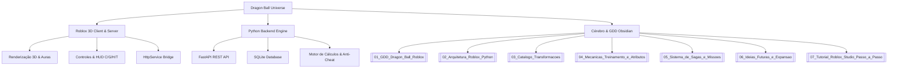

# 🧠 CÉREBRO DO JOGO: DRAGON BALL ROBLOX & PYTHON ENGINE

> [!NOTE]
> Bem-vindo ao **Cérebro de Conhecimento e Game Design** do jogo de Dragon Ball integrado entre Roblox e Python. Este cofre (Vault do Obsidian) centraliza todas as ideias, sistemas matemáticos, arquitetura técnica e roadmaps do projeto.

---

## 🗺️ Mapa Mental do Projeto (Visão Geral)

---

## 📑 Índice Rápido dos Módulos

| Módulo | Descrição | Link Obsidian |
| :--- | :--- | :--- |
| **01. Game Design Document** | Visão geral, público-alvo, lore e loop principal | [[01_GDD_Dragon_Ball_Roblox]] |
| **02. Arquitetura Técnica** | Comunicação HTTP Roblox $\leftrightarrow$ Python | [[02_Arquitetura_Roblox_Python]] |
| **03. Catálogo de Transformações** | Multiplicadores de poder, dreno de Ki e auras | [[03_Catalogo_Transformacoes]] |
| **04. Treinamento e Atributos** | Fórmulas de cálculo de Poder de Luta e Zenkai | [[04_Mecanicas_Treinamento_e_Atributos]] |
| **05. Sagas e Missões** | De Raditz ao Torneio do Poder com chefes e XP | [[05_Sistema_de_Sagas_e_Missoes]] |
| **06. Ideias Futuras e Expansão** | Esferas do Dragão, Fusões, PvP e Guildas | [[06_Ideias_Futuras_e_Expansao]] |
| **07. Guia do Roblox Studio** | Passo a passo de instalação e execução | [[07_Tutorial_Roblox_Studio_Passo_a_Passo]] |

---

## ⚡ Atalhos de Gameplay Planejados

- **`[C]` (Segurar)**: Carregar Ki e liberar partículas de aura.
- **`[G]`**: Despertar a transformação mais poderosa desbloqueada.
- **`[H]`**: Reverter para a Forma Base para poupar energia.
- **`[T]`**: Abrir menu de rotinas de treino.
- **`[M]`**: Abrir painel de Sagas e Missões ativas.
- **`[Q]`**: Ki Dash (investida em alta velocidade baseada em Agilidade).

---

## 🎯 Objetivos Centrais de Desenvolvimento
1. [x] Estruturar o servidor Python em FastAPI com modelos de dados Pydantic.
2. [x] Criar banco de dados SQLite persistente para os jogadores.
3. [x] Implementar simulador interativo no terminal Python (`play_cli.py`).
4. [x] Escrever scripts Luau para Roblox (`ServerScriptService` e `StarterPlayerScripts`).
5. [x] Documentar o cofre Obsidian com conceitos e fórmulas matemáticas.
6. [ ] Adicionar suporte a Fusões Potara e Metamoru.
7. [ ] Criar sistema de busca pelas 7 Esferas do Dragão e invocação de Shenlong.
