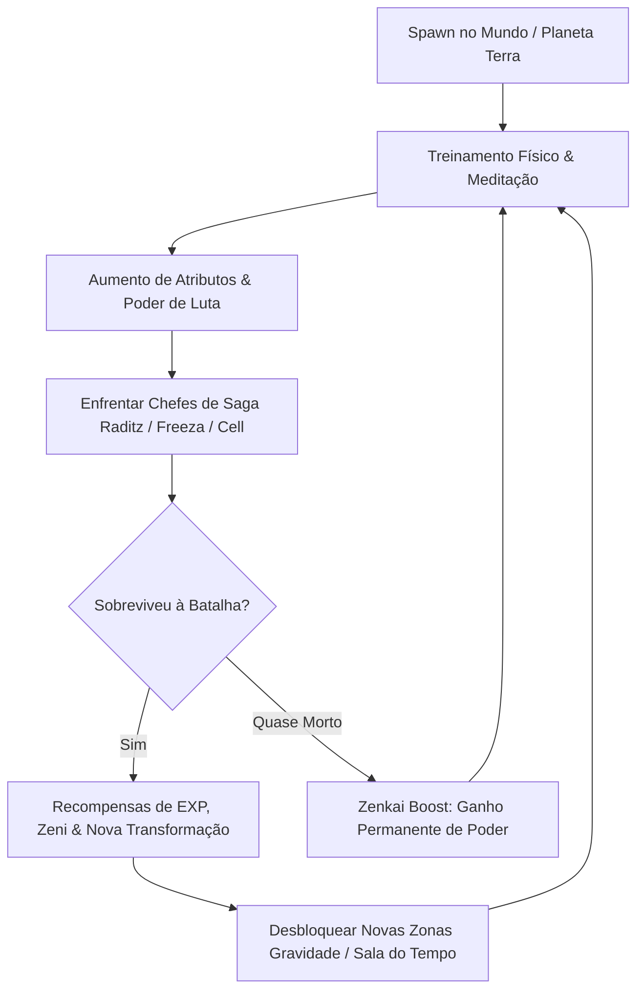

# 📜 Game Design Document (GDD)

## 1. Visão Geral do Jogo
- **Nome do Projeto**: *Dragon Ball: Saiyan Odyssey*
- **Gênero**: MMORPG de Ação / Anime Fighting Simulator
- **Plataforma**: Roblox (PC, Mobile e Console) com motor de regras em Python
- **Público-Alvo**: Fãs de Dragon Ball Z/Super e jogadores de RPGs no Roblox

---

## 2. A Fantasia do Jogador
O jogador entra no universo como um guerreiro Saiyajin novato com poder de luta modesto (100 a 200 PL). Através de disciplina física rigorosa, meditação e batalhas épicas com guerreiros espaciais, o jogador rompe seus limites mortais até despertar o lendário **Super Saiyajin**, dominar o **Ki dos Deuses** e finalmente atingir estados divinos como o **Instinto Superior** ou o **Ultra Ego**.

---

## 3. O Loop Central de Gameplay (Core Loop)

---

## 4. Pilares de Design

### Pilar 1: Sensação de Impacto e Poder
Cada transformação precisa alterar visivelmente:
- A aura ao redor do personagem (cor, partículas, brilho e distorção).
- A velocidade de corrida e altura do pulo (`WalkSpeed` e `JumpPower`).
- O tremor da câmera e efeitos de relâmpagos estalando pelo ar.

### Pilar 2: Gestão Estratégica de Energia (Ki Management)
Transformações mais fortes multiplicam seu poder em níveis astronômicos (até 25.000x), mas **drenam o Ki rapidamente**. O jogador deve decidir quando entrar na forma para desferir dano crítico e quando recuar para carregar energia.

### Pilar 3: Progressão Conectada via Python
O Roblox não armazena regras críticas de progressão localmente para impedir hackers e executores de script. Toda a matemática de combate, evolução de atributos e validação de missões ocorre de forma segura no **Backend Python**.

---

## 5. Próximos Documentos Recomendados
- Consulte [[03_Catalogo_Transformacoes]] para ver detalhes das formas.
- Consulte [[04_Mecanicas_Treinamento_e_Atributos]] para as fórmulas de atributos.
- Consulte [[05_Sistema_de_Sagas_e_Missoes]] para o enredo e progressão.
