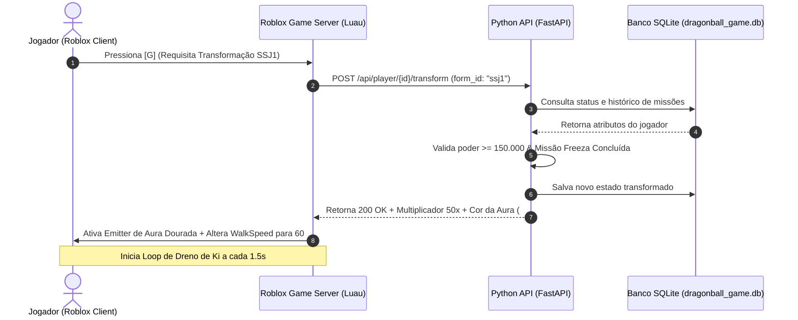

# ⚙️ Arquitetura Técnica: Roblox + Python

## 1. Por que integrar Python com Roblox?
O Roblox executa nativamente **Luau** (uma variante otimizada de Lua 5.1). No entanto, estúdios profissionais de Roblox utilizam servidores externos em linguagens como **Python** para:
1. **Segurança Anti-Cheat Autoritativa**: Validações de poder, inventário e desbloqueios ocorrem fora do alcance de executores maliciosos (`Injectors/Exploits`).
2. **Persistência Global e Cross-Server**: Jogadores podem transitar entre diferentes servidores de jogos mantendo seus dados intactos e sincronizados em tempo real no banco SQLite/Postgres.
3. **Simulações Complexas e IA**: Utilização de inteligência artificial em Python para balancear atributos, gerar eventos dinâmicos e calcular economias complexas.
4. **Modo Híbrido**: Permite testar a lógica do jogo no terminal local com `play_cli.py` sem nem precisar abrir o Roblox Studio.

---

## 2. Diagrama de Comunicação de Redes

---

## 3. Estrutura dos Endpoints REST

| Método | Endpoint | Descrição |
| :--- | :--- | :--- |
| `GET` | `/api/player/{user_id}` | Obtém perfil completo e cria Saiyajin caso seja novato |
| `POST` | `/api/player/{user_id}/train` | Processa ciclo de treino (Flexões, Meditação, Gravidade) |
| `POST` | `/api/player/{user_id}/transform` | Ativa uma transformação Saiyajin |
| `POST` | `/api/player/{user_id}/revert` | Retorna o guerreiro à Forma Base |
| `POST` | `/api/player/{user_id}/charge_ki` | Carrega o medidor de Ki |
| `POST` | `/api/player/{user_id}/drain_tick` | Drena Ki periodicamente durante transformações |
| `POST` | `/api/player/{user_id}/zenkai` | Ativa o bônus permanente de quase-morte |
| `GET` | `/api/transformations` | Catálogo completo de formas e requisitos |
| `GET` | `/api/quests` | Catálogo de sagas e chefes |
| `POST` | `/api/player/{user_id}/complete_quest` | Valida combate e concede recompensas de XP e formas |

---

## 4. Segurança e Produção
- Em ambiente de desenvolvimento local, a conexão ocorre em `http://127.0.0.1:8000`.
- Para testes online ou servidores de produção no Roblox, o backend Python pode ser hospedado em servidores como Railway, Render, VPS ou utilizando túneis seguros como **Cloudflare Tunnels** ou **Ngrok**.
- As requisições podem incluir tokens de autenticação no Header (`Authorization: Bearer <SECRET_TOKEN>`) para garantir que apenas os servidores legítimos do Roblox possam requisitar alterações de status.
