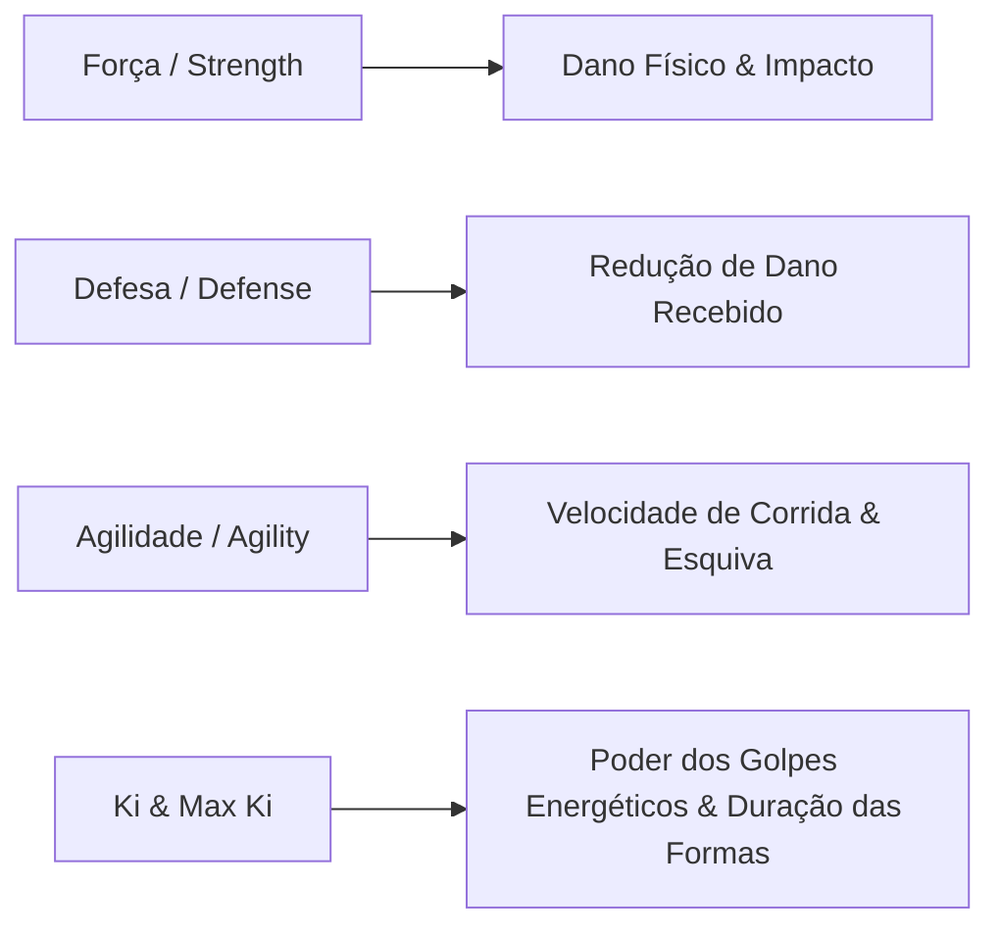

# 🏋️ Mecânicas de Treinamento e Sistema de Atributos

## 1. Atributos Fundamentais do Personagem

O guerreiro possui 4 atributos essenciais que ditam sua performance em combate:

---

## 2. A Fórmula Matemática do Poder de Luta (Power Level)

O Poder de Luta (PL) exibido no scouter e no HUD do Roblox é calculado autoritativamente pelo motor em Python através da seguinte equação:

$$\text{Poder Base} = (\text{Força} \times 10) + (\text{Defesa} \times 8) + (\text{Agilidade} \times 6) + (\text{Ki Máximo} \times 2)$$

Quando uma transformação está ativa, o poder total é multiplicado:

$$\text{Poder Total} = \text{Poder Base} \times \text{Multiplicador da Forma}$$

> [!NOTE]
> Um guerreiro com $1.000$ de Força, $800$ de Defesa, $600$ de Agilidade e $2.000$ de Ki Máximo terá:
> $$\text{Poder Base} = (1000 \times 10) + (800 \times 8) + (600 \times 6) + (2000 \times 2) = 10.000 + 6.400 + 3.600 + 4.000 = 24.000\text{ PL}$$
> Ao ativar o **Super Saiyajin 1** ($50\times$), seu Poder de Luta salta para:
> $$24.000 \times 50 = 1.200.000\text{ PL}$$

---

## 3. Tipos de Treinamento Disponíveis

### A) Flexões e Agachamentos (`pushups`)
- **Foco**: Força e Defesa corporal.
- **Ambiente**: Qualquer local do mapa.
- **Rendimento**: $+5$ Força, $+4$ Defesa por ciclo de 5 segundos.

### B) Treino de Sombras (`shadow_boxing`)
- **Foco**: Reflexos, coordenação e controle de Ki.
- **Ambiente**: Planícies e áreas abertas.
- **Rendimento**: $+6$ Agilidade, $+5$ Ki Máximo por ciclo.

### C) Meditação Profunda (`meditation`)
- **Foco**: Expansão espiritual do receptáculo de Ki e regeneração acelerada.
- **Ambiente**: Pico das Nuvens ou Templo Sagrado.
- **Rendimento**: $+15$ Ki Máximo, $+25$ Ki Atual, $+2$ Defesa por ciclo.

### D) Sala de Gravidade 100G (`gravity_chamber`)
- **Foco**: Multiplicador massivo em todos os atributos.
- **Requisito**: Nave da Corporação Cápsula.
- **Rendimento**: $+12$ Força, $+10$ Defesa, $+10$ Agilidade, $+10$ Ki Máximo.

### E) Sala do Tempo Hiperbólica (`hyperbolic_time`)
- **Foco**: 1 dia no mundo real equivale a 1 ano de treino extremo.
- **Requisito**: Nível 20 ou $100.000$ de Poder de Luta.
- **Rendimento**: $+25$ Força, $+25$ Defesa, $+20$ Agilidade, $+30$ Ki Máximo por ciclo.

---

## 4. O Mecanismo do Zenkai Boost (Genética Saiyajin)

Quando um jogador sofre dano crítico (vida abaixo de 10%) ou é derrotado em uma batalha contra chefes de saga e sobrevive:
1. O backend em Python ativa a função `apply_zenkai_boost()`.
2. O contador de Zenkai é incrementado (`zenkai_count += 1`).
3. **Todos os atributos do jogador ganham um bônus permanente de $+15\%$!**
4. A vida e o Ki são restaurados ao limite máximo.
