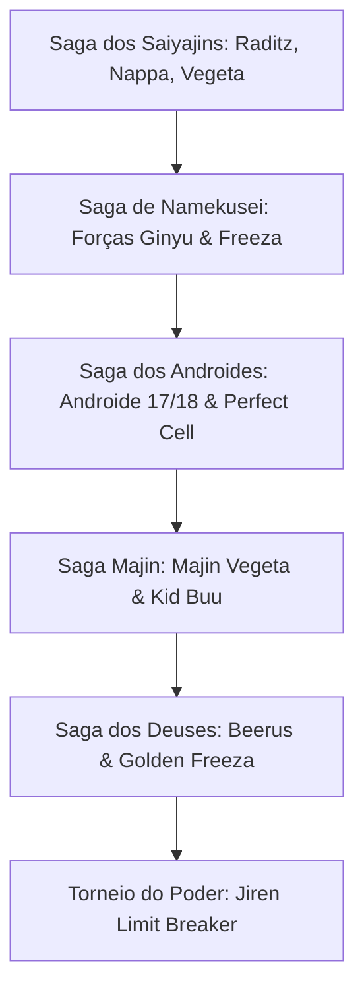

# ⚔️ Sistema de Sagas, Missões e Chefes

> [!IMPORTANT]
> A progressão narrativa segue a cronologia clássica de Dragon Ball Z e Dragon Ball Super. Cada saga possui chefes com inteligência artificial e mecânicas exclusivas no Roblox.

---

## 🗺️ Mapa de Progressão das Sagas

---

## 📜 Detalhamento das Missões e Desbloqueios

### 1. Saga dos Saiyajins
- **Missão 1: Ameaça Espacial - Derrote Raditz**
  - *Inimigo*: Raditz
  - *Poder Recomendado*: $300$ PL
  - *Recompensa*: $500$ EXP, ¥$1.000$ Zeni, desbloqueio da técnica **Kaioken**.
- **Missão 2: O Gigante Nappa**
  - *Inimigo*: Nappa
  - *Poder Recomendado*: $4.000$ PL
  - *Recompensa*: $2.500$ EXP, ¥$5.000$ Zeni.
- **Missão 3: O Príncipe dos Saiyajins**
  - *Inimigo*: Vegeta Forma Base / Oozaru (Macaco Gigante)
  - *Poder Recomendado*: $18.000$ PL
  - *Recompensa*: $8.000$ EXP, ¥$15.000$ Zeni.

---

### 2. Saga de Namekusei
- **Missão 4: O Tirano Galáctico - Freeza 100%**
  - *Inimigo*: Freeza Forma Final
  - *Cenário*: Namekusei em erupção vulcânica
  - *Poder Recomendado*: $120.000$ PL
  - *Recompensa*: $50.000$ EXP, ¥$100.000$ Zeni, desbloqueio lendário do **Super Saiyajin 1 (SSJ1)**.

---

### 3. Saga dos Androides & Cell
- **Missão 5: Os Jogos de Cell**
  - *Inimigo*: Perfect Cell
  - *Cenário*: Arena dos Cell Games
  - *Poder Recomendado*: $450.000$ PL
  - *Mecânica do Chefe*: Regeneração celular caso a vida chegue a 20%.
  - *Recompensa*: $200.000$ EXP, ¥$300.000$ Zeni, desbloqueio do **Super Saiyajin 2 (SSJ2)**.

---

### 4. Saga de Majin Buu
- **Missão 6: O Monstro Ancestral - Kid Buu**
  - *Inimigo*: Kid Buu
  - *Cenário*: Planeta Sagrado dos Kaioshins
  - *Poder Recomendado*: $2.000.000$ PL
  - *Recompensa*: $1.000.000$ EXP, ¥$1.000.000$ Zeni, desbloqueio do **Super Saiyajin 3 (SSJ3)**.

---

### 5. Saga dos Deuses & Torneio do Poder
- **Missão 7: O Despertar do Deus da Destruição**
  - *Inimigo*: Lord Beerus
  - *Poder Recomendado*: $8.000.000$ PL
  - *Recompensa*: $5.000.000$ EXP, desbloqueio do **Super Saiyajin Deus (SSJ God)**.
- **Missão 8: O Renascimento Dourado**
  - *Inimigo*: Golden Freeza
  - *Poder Recomendado*: $40.000.000$ PL
  - *Recompensa*: $15.000.000$ EXP, desbloqueio do **Super Saiyajin Blue**.
- **Missão 9: O Invencível Jiren**
  - *Inimigo*: Jiren Limit Breaker
  - *Cenário*: Arena dos Universos no Mundo do Vazio
  - *Poder Recomendado*: $150.000.000$ PL
  - *Recompensa*: $50.000.000$ EXP, desbloqueio supremo do **Instinto Superior (Ultra Instinct)**.
