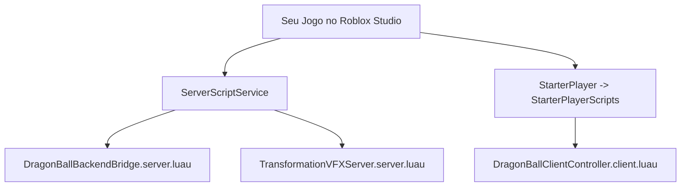

# 🛠️ Tutorial Passo a Passo: Configuração no Roblox Studio

> [!TIP]
> Siga este roteiro prático para colocar o jogo funcionando no seu Roblox Studio em menos de 5 minutos!

---

## 1. Preparar o Servidor Python
1. No seu computador, abra o PowerShell ou Prompt de Comando.
2. Navegue até a pasta do backend:
   ```powershell
   cd dragonball_roblox\backend_api
   ```
3. Instale as bibliotecas necessárias:
   ```powershell
   pip install fastapi uvicorn pydantic requests
   ```
4. Execute o servidor:
   ```powershell
   python main.py
   ```
   *Você verá a mensagem: `>>> Servidor Dragon Ball Backend inicializado com sucesso!`*

---

## 2. Configurar o Projeto no Roblox Studio
1. Abra o **Roblox Studio** e crie uma nova baseplate limpa (**Baseplate**).
2. Vá em **Home (Início)** -> **Game Settings (Configurações do Jogo)**.
3. Se o jogo ainda não foi salvo, clique em **Save to Roblox**.
4. Na aba **Security (Segurança)**:
   - Ative a opção **Allow HTTP Requests** (Permitir Requisições HTTP).
   - Clique em **Save**.

---

## 3. Inserir os Scripts do Jogo



1. **Scripts de Servidor**:
   - Vá no painel **Explorer** -> `ServerScriptService`.
   - Adicione um novo `Script` chamado `DragonBallBackendBridge` e cole o código do arquivo `roblox_scripts/ServerScriptService/DragonBallBackendBridge.server.luau`.
   - Adicione outro `Script` chamado `TransformationVFXServer` e cole o código do arquivo `roblox_scripts/ServerScriptService/TransformationVFXServer.server.luau`.

2. **Scripts de Cliente**:
   - Vá no painel **Explorer** -> `StarterPlayer` -> `StarterPlayerScripts`.
   - Adicione um `LocalScript` chamado `DragonBallClientController` e cole o código do arquivo `roblox_scripts/StarterPlayer/StarterPlayerScripts/DragonBallClientController.client.luau`.

---

## 4. Testar no Roblox Studio
- Clique no botão verde **Play (Jogar)** no topo do Roblox Studio.
- Observe:
  1. O HUD de Vida, Ki e Poder de Luta aparecerá no canto inferior.
  2. Pressione **`[T]`** para treinar e veja o poder subindo no HUD e no terminal do Python.
  3. Segure **`[C]`** para concentrar energia e carregar o Ki.
  4. Pressione **`[G]`** para liberar o Super Saiyajin ou a melhor forma disponível!
