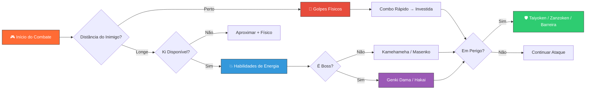

# ⚔️ Sistema de Golpes e Habilidades

> [!IMPORTANT]
> Este documento detalha todas as habilidades de combate disponíveis no jogo, incluindo fórmulas de dano, custos e estratégias de uso. Consulte [[03_Catalogo_Transformacoes]] para bônus de transformação aplicados ao dano.

---

## 📊 Categorias de Habilidades

```mermaid
flowchart TD
    SKILLS["🎯 Sistema de Habilidades"]
    
    SKILLS --> FISICO["🥊 Físicas"]
    SKILLS --> ENERGIA["💥 Energia / Ki"]
    SKILLS --> DIVINO["✨ Divinas"]
    SKILLS --> UTILIDADE["🛡️ Utilidade"]
    
    FISICO --> F1["Soco Meteoro"]
    FISICO --> F2["Chute Furacão"]
    FISICO --> F3["Combo Rápido"]
    FISICO --> F4["Investida Poderosa"]
    
    ENERGIA --> E1["Kamehameha"]
    ENERGIA --> E2["Genki Dama"]
    ENERGIA --> E3["Makankosappo"]
    ENERGIA --> E4["Final Flash"]
    ENERGIA --> E5["Galick Ho"]
    ENERGIA --> E6["Masenko"]
    ENERGIA --> E7["Dodon Ray"]
    
    DIVINO --> D1["Hakai"]
    DIVINO --> D2["Esfera do Destruidor"]
    DIVINO --> D3["Kamehameha Divino"]
    
    UTILIDADE --> U1["Taiyoken"]
    UTILIDADE --> U2["Zanzoken"]
    UTILIDADE --> U3["Barreira de Ki"]
    
    style SKILLS fill:#ff6b35,stroke:#333,color:#fff
    style FISICO fill:#e74c3c,stroke:#333,color:#fff
    style ENERGIA fill:#3498db,stroke:#333,color:#fff
    style DIVINO fill:#9b59b6,stroke:#333,color:#fff
    style UTILIDADE fill:#2ecc71,stroke:#333,color:#fff
```



---

## 📋 Tabela Completa de Habilidades

### 🥊 Habilidades Físicas

| Nome | Tipo | Dano Mult. | Custo Ki | Cooldown (s) | Desbloqueio | Descrição |
|------|------|-----------|----------|-------------|-------------|-----------|
| Soco Meteoro | Físico | 1.5x | 5 | 3 | Nível 1 | Soco básico com impacto aumentado. Golpe inicial de todo guerreiro. |
| Chute Furacão | Físico | 1.8x | 8 | 4 | Nível 5 | Chute giratório que atinge múltiplos inimigos próximos. |
| Combo Rápido | Físico | 2.5x (5 hits) | 15 | 6 | Nível 12 | Sequência veloz de 5 golpes consecutivos. Cada hit causa 0.5x. |
| Investida Poderosa | Físico | 3.0x | 20 | 8 | Nível 20 | Avanço devastador em linha reta. Causa knockback. |

### 💥 Habilidades de Energia / Ki

| Nome | Tipo | Dano Mult. | Custo Ki | Cooldown (s) | Desbloqueio | Descrição |
|------|------|-----------|----------|-------------|-------------|-----------|
| Kamehameha | Energia | 3.5x | 25 | 8 | Nível 10 | O lendário feixe de Ki concentrado nas palmas. |
| Genki Dama | Energia | 8.0x | 80 | 60 | Nível 40 | Esfera massiva que reúne energia de todos os seres vivos. |
| Makankosappo | Energia | 4.0x | 30 | 10 | Nível 15 | Feixe perfurante espiralado com poder de penetração. |
| Final Flash | Energia | 5.0x | 45 | 15 | Nível 25 | Onda de energia devastadora carregada com ambas as mãos. |
| Galick Ho | Energia | 3.2x | 22 | 7 | Nível 8 | Rajada de energia roxa com grande alcance. |
| Masenko | Energia | 2.8x | 18 | 6 | Nível 6 | Onda de Ki disparada sobre a cabeça. Técnica ensinada por Piccolo. |
| Dodon Ray | Energia | 2.0x | 10 | 4 | Nível 3 | Feixe fino e preciso disparado pelo dedo indicador. |

### ✨ Habilidades Divinas

| Nome | Tipo | Dano Mult. | Custo Ki | Cooldown (s) | Desbloqueio | Descrição |
|------|------|-----------|----------|-------------|-------------|-----------|
| Hakai | Divino | 10.0x | 100 | 90 | Nível 45 + God Ki | Poder da destruição. Desintegra o alvo com energia divina. |
| Esfera do Destruidor | Divino | 7.0x | 70 | 45 | Nível 42 + God Ki | Esfera de energia destrutiva similar à dos Deuses da Destruição. |
| Kamehameha Divino | Divino | 6.0x | 55 | 20 | Nível 35 + SSJ Blue | Versão divina do Kamehameha, imbuída com God Ki. |

### 🛡️ Habilidades de Utilidade

| Nome | Tipo | Dano Mult. | Custo Ki | Cooldown (s) | Desbloqueio | Descrição |
|------|------|-----------|----------|-------------|-------------|-----------|
| Taiyoken | Utilidade | 0x (cega) | 10 | 15 | Nível 7 | Flash solar que cega inimigos por 3 segundos. |
| Zanzoken | Utilidade | 0x (dodge) | 8 | 5 | Nível 4 | Movimento ultrarrápido de esquiva. Torna invulnerável por 0.5s. |
| Barreira de Ki | Utilidade | 0x (defesa) | 20 | 12 | Nível 14 | Escudo de energia que absorve 50% do dano por 4 segundos. |

---

## 📖 Lore das Habilidades Icônicas

### 💙 Kamehameha — A Onda Tartaruga

A **Kamehameha** é a técnica mais emblemática de toda a série Dragon Ball. Criada pelo **Mestre Kame (Muten Roshi)** após **50 anos de treinamento**, esta técnica concentra o Ki nas palmas das mãos e o libera como um feixe devastador de energia azul.

O nome vem do lendário rei havaiano **Kamehameha I**, e o gesto icônico — mãos unidas ao lado do corpo com o grito *"Ka... me... ha... me... HAAAAA!"* — tornou-se um dos movimentos mais reconhecíveis da cultura pop mundial.

**Goku** aprendeu a técnica instantaneamente após vê-la uma única vez, algo que chocou até o próprio Muten Roshi. No jogo, o Kamehameha serve como a habilidade de energia fundamental, com dano sólido e custo moderado.

> [!TIP]
> O Kamehameha é a melhor habilidade custo-benefício de energia. Use-o como seu golpe principal até desbloquear técnicas superiores.

### 🌍 Genki Dama — A Esfera Espiritual

A **Genki Dama (Spirit Bomb)** é uma técnica ensinada pelo **Senhor Kaio** no **Planeta do Kaio**, acessível pela **Estrada da Serpente**. Ela funciona reunindo pequenas frações de energia vital de **todos os seres vivos** ao redor — plantas, animais, pessoas e até o próprio planeta.

A condição para usar a Genki Dama é ter um **coração puro**, razão pela qual Vegeta nunca pôde utilizá-la. No jogo, esta restrição se traduz em um **alto nível de desbloqueio** e o **maior cooldown** do jogo (60 segundos), mas em contrapartida oferece o **maior multiplicador de dano** entre as habilidades de energia (8.0x).

Momentos icônicos: contra **Vegeta** (Saga Saiyan), contra **Freeza** (Saga Namek) e a versão universal contra **Kid Buu** (Saga Buu).

### 🌀 Makankosappo — O Feixe Perfurante Espiral

O **Makankosappo (Special Beam Cannon)** foi desenvolvido por **Piccolo** especificamente para derrotar Goku. É um feixe de energia que gira em espiral como um **saca-rolhas**, conferindo-lhe incrível poder de **penetração e perfuração**.

Esta técnica foi usada no momento mais marcante da série original: quando Piccolo a disparou contra **Raditz**, atravessando tanto o Saiyan invasor quanto **Goku**, que segurava o irmão por trás — o primeiro sacrifício de Goku na série.

No jogo, o Makankosappo possui dano elevado (4.0x) e é especialmente eficaz contra **inimigos com alta defesa**, ignorando parcialmente a resistência do alvo.

### ⚡ Final Flash — A Explosão Final

O **Final Flash** é a técnica suprema de **Vegeta**, desenvolvida durante seu treinamento na **Sala do Tempo e do Espírito (Hyperbolic Time Chamber)**. Vegeta canaliza todo o seu Ki em ambas as mãos estendidas e libera uma onda massiva de energia dourada.

Seu momento mais glorioso foi contra **Cell Perfeito** na Saga Cell, quando a explosão foi tão poderosa que quase destruiu a **Terra inteira**. No jogo, o Final Flash é uma das habilidades mais fortes, mas com custo e cooldown altos, perfeita para momentos decisivos.

### 💜 Galick Ho — O Orgulho Saiyan

O **Galick Ho** é a técnica assinatura original de **Vegeta**, usada em seu confronto épico contra Goku durante a **Saga Saiyan**. O feixe roxo colidiu diretamente com o Kamehameha de Goku em um dos momentos mais icônicos da série — o **beam clash** que definiu a rivalidade entre os dois Saiyans.

### 💛 Masenko — Herança do Mestre

O **Masenko** é a primeira técnica de energia que **Gohan** aprendeu, ensinada por **Piccolo** durante o treinamento de um ano antes da chegada dos Saiyans. A técnica é disparada com as mãos unidas sobre a cabeça, diferente do Kamehameha. Representa o vínculo entre mestre e aluno — Piccolo e Gohan.

### 🔴 Hakai — O Poder da Destruição

**Hakai** significa literalmente "destruição" em japonês. É o poder exclusivo dos **Deuses da Destruição (Hakaishin)**, capaz de **apagar qualquer coisa da existência** — não apenas matar, mas erradicar completamente. No anime, **Beerus** demonstra este poder ao desintegrar objetos e seres com um simples gesto.

No jogo, o Hakai é a **habilidade mais poderosa** (10.0x), mas requer o mais alto nível de desbloqueio e a presença de **God Ki**, tornando-o uma recompensa de endgame.

> [!WARNING]
> O Hakai exige God Ki ativo. Certifique-se de ter desbloqueado o caminho divino em [[03_Catalogo_Transformacoes]] antes de tentar utilizá-lo.

---

## 🔢 Fórmula de Cálculo de Dano

O dano de cada habilidade é calculado pela seguinte fórmula:

```
dano_final = (ataque_base + bonus_equipamento) * multiplicador_skill * bonus_transformacao * (1 - defesa_alvo / (defesa_alvo + 100))
```

### Componentes

| Componente | Descrição | Exemplo |
|-----------|-----------|---------|
| `ataque_base` | Atributo de ataque do personagem (ver [[04_Mecanicas_Treinamento_e_Atributos]]) | 150 |
| `bonus_equipamento` | Bônus de itens equipados (ver [[09_Sistema_de_Loja_e_Inventario]]) | +30 |
| `multiplicador_skill` | Multiplicador da habilidade usada | 3.5x (Kamehameha) |
| `bonus_transformacao` | Multiplicador da transformação ativa (ver [[03_Catalogo_Transformacoes]]) | 1.5x (SSJ) |
| `defesa_alvo` | Defesa total do alvo | 80 |

### Exemplo de Cálculo

**Cenário:** Guerreiro Nível 20, usando Kamehameha, transformado em Super Saiyajin, contra inimigo com 80 de defesa.

```
ataque_base = 150
bonus_equipamento = 30
multiplicador_skill = 3.5 (Kamehameha)
bonus_transformacao = 1.5 (SSJ)
defesa_alvo = 80

dano_bruto = (150 + 30) * 3.5 * 1.5
           = 180 * 3.5 * 1.5
           = 945

fator_defesa = 1 - (80 / (80 + 100))
             = 1 - 0.444
             = 0.556

dano_final = 945 * 0.556
           ≈ 525 de dano
```

> [!NOTE]
> Dano crítico tem 15% de chance de ocorrer e aplica um multiplicador adicional de 1.75x. No exemplo acima, um crítico causaria aproximadamente **919 de dano**.

---

## 🎯 Guia de Estratégia por Tipo

### 🥊 Quando Usar Habilidades Físicas

- **Combate corpo-a-corpo** contra inimigos próximos
- **Quando o Ki estiver baixo** — golpes físicos têm custo menor
- **Combo Rápido** é ideal para **stunlock** em PvP
- **Investida Poderosa** serve para iniciar combates com vantagem (gap closer)

### 💥 Quando Usar Habilidades de Energia

- **Combate à distância** para manter segurança
- **Kamehameha** como golpe padrão de dano consistente
- **Genki Dama** apenas em bosses ou quando tiver suporte de aliados (cast time longo)
- **Makankosappo** contra inimigos "tanques" com alta defesa
- **Final Flash** como finalizador em combates longos

### ✨ Quando Usar Habilidades Divinas

- **Endgame** — estas habilidades definem o meta de alto nível
- **Hakai** como último recurso contra bosses com muita vida
- **Kamehameha Divino** substitui o Kamehameha normal em builds divinas

### 🛡️ Quando Usar Habilidades de Utilidade

- **Taiyoken** para fugir de situações perigosas ou iniciar combos
- **Zanzoken** para esquivar ataques devastadores (timing é essencial)
- **Barreira de Ki** antes de receber golpes carregados ou ultimates inimigos



---

## 🔗 Links Relacionados

- [[00_DASHBOARD_CEREBRO]] — Painel central do projeto
- [[01_GDD_Dragon_Ball_Roblox]] — Game Design Document completo
- [[03_Catalogo_Transformacoes]] — Bônus de transformação no dano
- [[04_Mecanicas_Treinamento_e_Atributos]] — Atributos base e treino
- [[05_Sistema_de_Sagas_e_Missoes]] — Missões que desbloqueiam habilidades
- [[09_Sistema_de_Loja_e_Inventario]] — Equipamentos que afetam o dano
- [[10_Balanceamento_e_Economia]] — Balanceamento geral de dano e progressão
