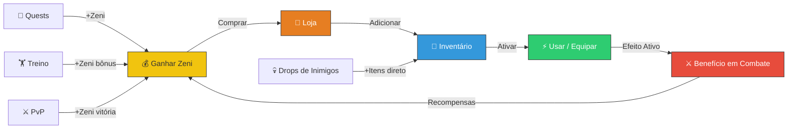
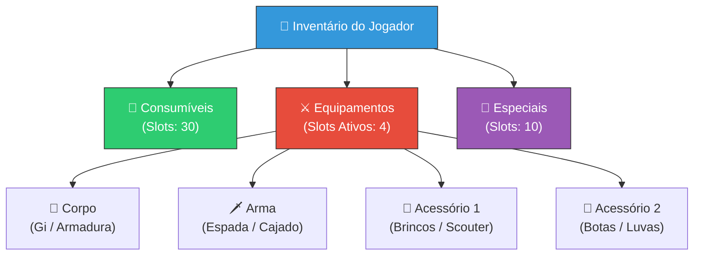

# 🛒 Sistema de Loja e Inventário

> [!IMPORTANT]
> Este documento cobre todo o sistema econômico de itens do jogo: a loja, o inventário do jogador, cada item disponível com lore detalhada, e o fluxo de aquisição. Para o balanceamento econômico completo, consulte [[10_Balanceamento_e_Economia]].

---

## 🔄 Fluxo do Sistema de Itens

---

## 📋 Tabela Completa de Itens

### 🧪 Consumíveis

| Nome | Preço (Zeni) | Efeito | Max Stack | Descrição |
|------|-------------|--------|-----------|-----------|
| Semente dos Deuses (Senzu Bean) | 500 | Restaura 100% HP e Ki | 5 | Feijão mágico cultivado por Yajirobe na Torre de Karin. |
| Poção de Ki Menor | 50 | Restaura 30% Ki | 20 | Concentrado líquido de energia vital básica. |
| Poção de Ki Maior | 150 | Restaura 70% Ki | 10 | Extrato concentrado de Ki purificado. |
| Poção de Vida Menor | 50 | Restaura 30% HP | 20 | Ervas medicinais comuns dos campos de treinamento. |
| Poção de Vida Maior | 150 | Restaura 70% HP | 10 | Remédio avançado preparado com técnicas de cura. |
| Água Sagrada | 800 | +20% ataque por 5 min | 3 | Água purificada do Templo Sagrado (Lookout) de Kami-Sama. |
| Fruta da Árvore Sagrada | 1200 | +30% todos atributos por 3 min | 2 | Fruta proibida da Árvore de Poder dos Deuses. |
| Antídoto | 30 | Remove debuffs | 15 | Cura envenenamento, paralisia e queimaduras. |

### ⚔️ Equipamentos

| Nome | Preço (Zeni) | Efeito | Max Stack | Descrição |
|------|-------------|--------|-----------|-----------|
| Gi de Treino | 200 | +5% XP de treino | 1 | Uniforme básico usado nas artes marciais. |
| Gi da Tartaruga | 800 | +10 ataque, +5 defesa | 1 | O icônico uniforme laranja da Escola Tartaruga de Muten Roshi. |
| Armadura Saiyan | 1500 | +20 defesa, +10 ataque | 1 | Armadura flexível da tecnologia militar do Planeta Vegeta. |
| Roupas Ponderadas | 600 | -10% velocidade, +15% XP | 1 | Roupas pesadas de treinamento, como as de Piccolo e Goku. |
| Brincos Potara | 3000 | +25 ataque, +25 defesa | 1 | Brincos sagrados dos Supremos Kaioshins. |
| Botas Herméticas | 400 | +10% velocidade | 1 | Botas leves para movimentação rápida em combate. |
| Luvas de Combate | 350 | +8 ataque | 1 | Luvas reforçadas para golpes físicos mais poderosos. |

### 🔧 Itens Especiais

| Nome | Preço (Zeni) | Efeito | Max Stack | Descrição |
|------|-------------|--------|-----------|-----------|
| Radar do Dragão | 5000 | Localiza Dragon Balls no mapa | 1 | Dispositivo criado por Bulma para detectar as esferas. |
| Cápsula Hoi-Poi | 100 | Armazena 10 itens extras | 5 | Tecnologia revolucionária da Corporação Cápsula de Dr. Brief. |
| Escaneador (Scouter) | 1000 | Mostra power level de inimigos | 1 | Dispositivo de leitura de poder usado pelo exército de Freeza. |
| Z-Sword (Espada Z) | 4000 | +40 ataque, habilidade especial | 1 | A lendária espada cravada na rocha do Planeta Sagrado dos Kais. |
| Cajado Mágico (Nyoibo) | 2000 | +15 ataque, alcance melee +50% | 1 | Bastão extensível herdado por Goku de seu avô Son Gohan. |

---

## 📖 Lore Detalhada dos Itens

### 🫘 Semente dos Deuses (Senzu Bean)

As **Sementes dos Deuses (Senzu Beans)** são cultivadas pelo gato imortal **Karin (Korin)** no topo da **Torre Karin**, uma torre de 800 metros que conecta a terra ao **Templo Sagrado (Lookout)** de Kami-Sama. Cada semente leva tempo considerável para amadurecer, e Karin as distribui com parcimônia.

Uma única Senzu restaura completamente a energia, cura ferimentos graves e ainda sacia a fome por **10 dias**. Na série, Goku e seus amigos sempre dependem dessas sementes nos momentos mais críticos de batalha.

**Yajirobe**, um guerreiro preguiçoso mas surpreendentemente forte, vive na Torre Karin e frequentemente é o responsável por entregar as sementes aos guerreiros Z nos campos de batalha.

> [!TIP]
> Reserve suas Senzu para lutas contra bosses. Para combates normais, use Poções de Vida/Ki que são muito mais baratas.

### 💧 Água Sagrada

A **Água Sagrada** é mantida no **Templo Sagrado (Lookout)**, a plataforma celestial flutuante acima da Torre Karin. No anime original, a Água Sagrada foi usada para **curar os humanos transformados** pelo Rei Piccolo Daimao.

O Templo é cuidado por **Mr. Popo**, o assistente milenar que serve cada Guardião da Terra. A água possui propriedades místicas que purificam o corpo e amplificam temporariamente o poder de luta de quem a bebe.

### 🗡️ Z-Sword (Espada Z)

A **Z-Sword (Zeta Sword)** estava cravada em uma rocha no **Planeta Sagrado dos Kais (Sacred World of the Kais)** por eras. Os Supremos Kaioshins acreditavam que quem conseguisse arrancá-la teria poder incomensurável.

**Gohan** foi levado ao planeta pelo **Supremo Kaioshin (Shin)** durante a **Saga Buu** e, após intenso treinamento, conseguiu arrancar a espada. Quando ela quebrou durante o treino, revelou-se que dentro dela estava selado o **Elder Kai (Rou Kaioshin)**, que possuía o poder de despertar o potencial oculto de qualquer guerreiro — o que levou ao **Gohan Ultimate (Mystic Gohan)**.

No jogo, a Z-Sword é um dos itens mais caros, mas oferece o maior bônus de ataque puro (+40) e desbloqueia uma habilidade especial exclusiva.

> [!NOTE]
> A Z-Sword é um item de endgame. Priorize a Armadura Saiyan e o Gi da Tartaruga antes de economizar para ela.

### 🏮 Gi da Tartaruga

O **Gi da Tartaruga (Kame Gi)** é o uniforme laranja com o kanji **"亀" (tartaruga)** nas costas, símbolo da **Escola Tartaruga (Kame-Sen Ryu)** do **Mestre Kame (Muten Roshi)**. Goku, Krillin e Yamcha treinaram sob Muten Roshi e vestiram este uniforme com orgulho.

Na série, o Gi passou por variações — às vezes com o kanji "悟" (sabedoria/percepção) representando o treinamento sob o Senhor Kaio. O uniforme é um símbolo de determinação e herança marcial.

### 🛡️ Armadura Saiyan

A **Armadura Saiyan** é uma peça de tecnologia militar do **Planeta Vegeta**, utilizada pelo exército Saiyan e posteriormente pelo exército de **Freeza**. Feita de um material elástico e ultra-resistente, a armadura se expande para acomodar a transformação **Oozaru (Grande Macaco)** e oferece proteção excepcional.

**Vegeta** e **Nappa** chegaram à Terra vestindo essas armaduras, e Bulma posteriormente replicou a tecnologia na **Corporação Cápsula** para os guerreiros Z usarem durante a viagem a Namek.

### 📡 Escaneador (Scouter)

O **Scouter** é um dispositivo eletrônico de medição de poder usado pelo **Exército de Freeza**. Colocado sobre um olho, ele detecta e quantifica o **power level** de seres vivos, exibindo o número na tela. Famosamente, o scouter de Raditz mediu o power level de Goku em apenas **334** quando ele não estava lutando.

A limitação do Scouter é que ele **não consegue medir** guerreiros que suprimem seu Ki, tornando-o inútil contra os Guerreiros Z após a Saga Namek. No jogo, o Scouter permite visualizar o nível de poder dos inimigos antes de engajar combate.

### 🔴 Radar do Dragão

O **Radar do Dragão (Dragon Radar)** é uma invenção da genial **Bulma**, criado quando ela tinha apenas **16 anos**. O dispositivo detecta a frequência de energia única emitida pelas **Dragon Balls** e as exibe como pontos em um mapa miniatura.

Sem o Radar, encontrar as sete esferas seria praticamente impossível, pois elas se espalham por todo o planeta após cada uso. No jogo, o Radar ativa um sistema de busca especial que marca as Dragon Balls no minimapa.

> [!IMPORTANT]
> O Radar do Dragão será essencial no Sprint 4 quando o sistema de busca de Dragon Balls for implementado. Veja [[11_Roadmap_e_Sprints]].

---

## 💰 Notas de Economia

### Ganhos Médios de Zeni

| Fonte | Zeni por Atividade | Frequência |
|-------|--------------------|-----------|
| Quest de Saga (principal) | 200–500 | Por quest completada |
| Quest diária | 100–200 | Uma vez por dia |
| Treino completado | 50–100 | Por sessão de treino |
| Vitória PvP | 150–300 | Por vitória |
| Derrota PvP | 25–50 | Por derrota |
| Drop de inimigo | 10–50 | Por inimigo derrotado |
| Boss derrotado | 500–2000 | Por boss |

### Análise de Custo-Benefício

| Investimento | Custo | Retorno Esperado |
|-------------|-------|-----------------|
| Gi de Treino (200 Zeni) | Baixo | +5% XP por treino = economia de horas a longo prazo |
| Roupas Ponderadas (600 Zeni) | Médio | +15% XP = melhor item de progressão do jogo |
| Senzu Bean (500 Zeni) | Alto | Salva de morte em boss fights — vale cada Zeni |
| Armadura Saiyan (1500 Zeni) | Alto | +20 defesa = sobrevivência muito maior |
| Z-Sword (4000 Zeni) | Muito Alto | +40 ataque = melhor arma do jogo |

> [!TIP]
> **Ordem de compra recomendada:** Gi de Treino → Roupas Ponderadas → Gi da Tartaruga → Senzu Beans (x3) → Armadura Saiyan → Z-Sword

---

## 🎒 Interface do Inventário

---

## 🔗 Links Relacionados

- [[00_DASHBOARD_CEREBRO]] — Painel central do projeto
- [[01_GDD_Dragon_Ball_Roblox]] — Game Design Document
- [[04_Mecanicas_Treinamento_e_Atributos]] — Atributos afetados por equipamentos
- [[08_Sistema_de_Golpes_e_Habilidades]] — Habilidades que se beneficiam dos itens
- [[10_Balanceamento_e_Economia]] — Balanceamento econômico detalhado
- [[11_Roadmap_e_Sprints]] — Roadmap de desenvolvimento
