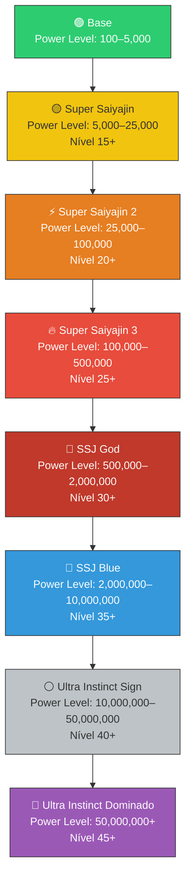
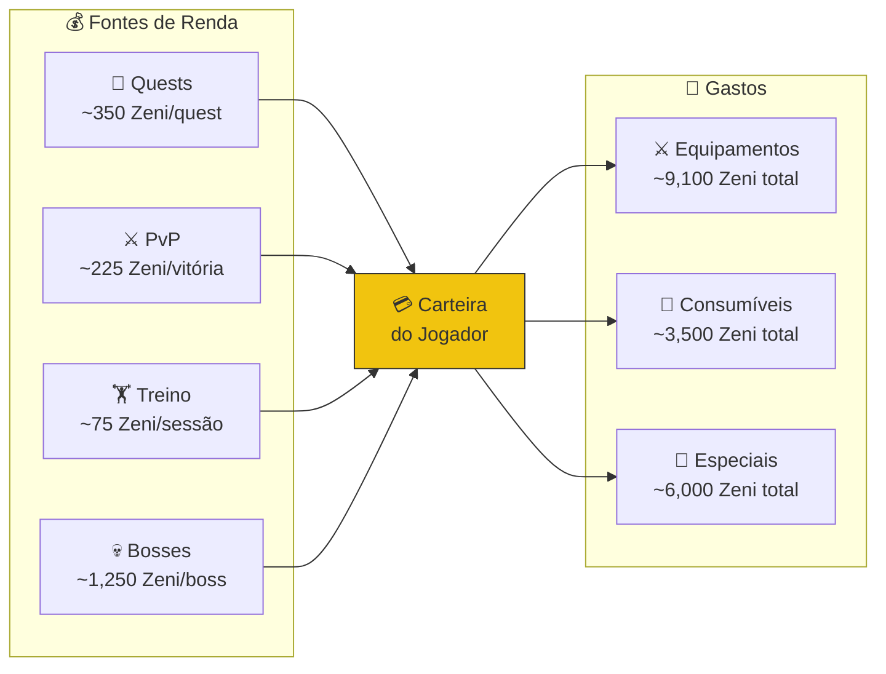
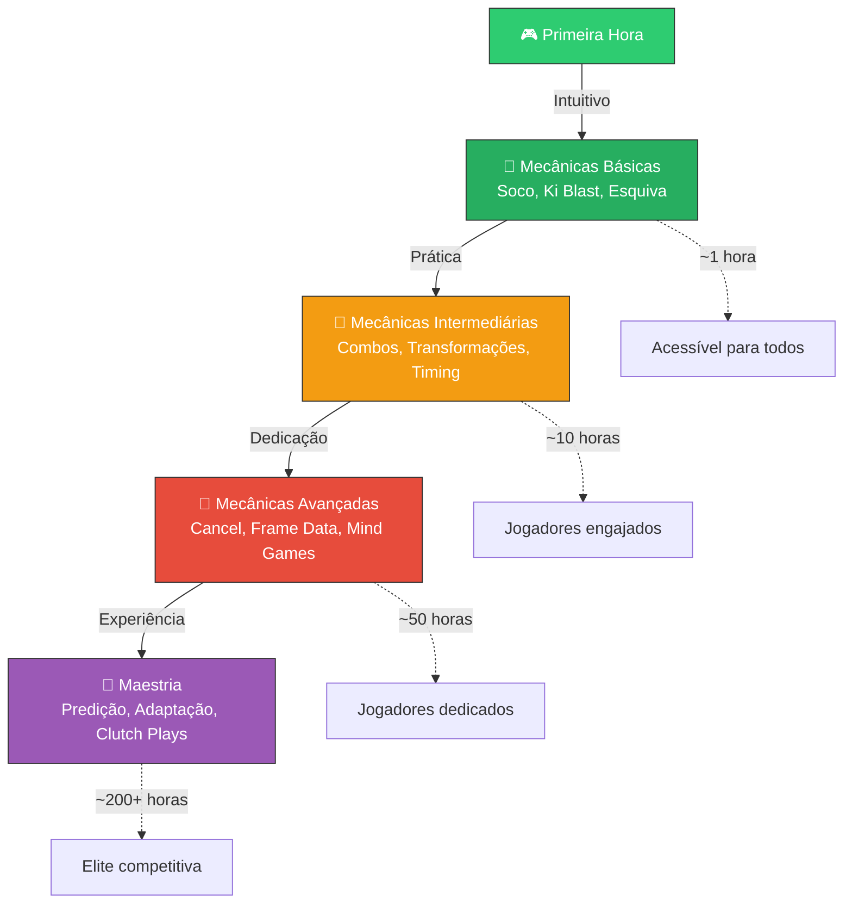
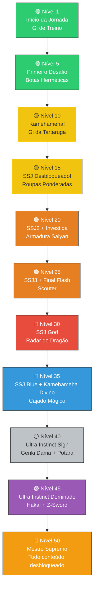

# ⚖️ Balanceamento e Economia do Jogo

> [!IMPORTANT]
> Este documento contém toda a análise de balanceamento, curvas de progressão, economia de Zeni e filosofia de design. É o guia central para garantir que o jogo seja justo, divertido e recompensador em todos os níveis.

---

## 📈 Curva de XP — Progressão Exponencial

### Fórmula Base

A experiência necessária para subir de nível segue uma **curva exponencial** com fator de crescimento de **1.5x**:

```
xp_necessario(nivel) = 100 * (1.5 ^ (nivel - 1))
```

Onde:
- **Nível 1 → 2** requer **100 XP** (base)
- Cada nível subsequente requer **1.5x** mais XP que o anterior
- A curva garante progressão rápida no início e desafio crescente no endgame

> [!NOTE]
> O fator 1.5 foi escolhido para equilibrar entre uma progressão satisfatória (não tão lenta quanto 2.0x) e desafio real no endgame (não tão rápida quanto 1.2x). A referência é a progressão de jogos clássicos de RPG como Final Fantasy e Dragon Quest.

### Tabela de Progressão — Níveis 1 a 50

| Nível | XP Necessário | XP Acumulado | Horas Estimadas | Marco / Desbloqueio |
|-------|--------------|-------------|----------------|---------------------|
| 1 | — | 0 | 0.0 | 🎮 Início do jogo |
| 2 | 100 | 100 | 0.2 | |
| 3 | 150 | 250 | 0.4 | 🔫 Dodon Ray |
| 4 | 225 | 475 | 0.7 | 🏃 Zanzoken |
| 5 | 338 | 813 | 1.0 | 🦵 Chute Furacão |
| 6 | 506 | 1,319 | 1.5 | 💛 Masenko |
| 7 | 759 | 2,078 | 2.0 | ☀️ Taiyoken |
| 8 | 1,139 | 3,217 | 2.8 | 💜 Galick Ho |
| 9 | 1,709 | 4,926 | 3.8 | |
| 10 | 2,563 | 7,489 | 5.0 | 💙 Kamehameha |
| 11 | 3,844 | 11,333 | 6.5 | |
| 12 | 5,767 | 17,100 | 8.5 | 👊 Combo Rápido |
| 13 | 8,650 | 25,750 | 11 | |
| 14 | 12,975 | 38,725 | 14 | 🛡️ Barreira de Ki |
| 15 | 19,463 | 58,188 | 18 | 🌀 Makankosappo, ⚡ SSJ desbloqueável |
| 16 | 29,194 | 87,382 | 22 | |
| 17 | 43,791 | 131,173 | 27 | |
| 18 | 65,687 | 196,860 | 33 | |
| 19 | 98,530 | 295,390 | 40 | |
| 20 | 147,795 | 443,185 | 48 | 💪 Investida Poderosa, ⚡ SSJ2 desbloqueável |
| 21 | 221,693 | 664,878 | 58 | |
| 22 | 332,539 | 997,417 | 70 | |
| 23 | 498,809 | 1,496,226 | 84 | |
| 24 | 748,213 | 2,244,439 | 100 | |
| 25 | 1,122,320 | 3,366,759 | 120 | ⚡ Final Flash, ⚡ SSJ3 desbloqueável |
| 26 | 1,683,479 | 5,050,238 | 142 | |
| 27 | 2,525,219 | 7,575,457 | 168 | |
| 28 | 3,787,829 | 11,363,286 | 198 | |
| 29 | 5,681,743 | 17,045,029 | 232 | |
| 30 | 8,522,615 | 25,567,644 | 272 | ⚡ SSJ God desbloqueável |
| 31 | 12,783,922 | 38,351,566 | 318 | |
| 32 | 19,175,883 | 57,527,449 | 370 | |
| 33 | 28,763,825 | 86,291,274 | 430 | |
| 34 | 43,145,737 | 129,437,011 | 498 | |
| 35 | 64,718,606 | 194,155,617 | 575 | ✨ Kamehameha Divino, ⚡ SSJ Blue desbloqueável |
| 36 | 97,077,909 | 291,233,526 | 662 | |
| 37 | 145,616,863 | 436,850,389 | 760 | |
| 38 | 218,425,295 | 655,275,684 | 870 | |
| 39 | 327,637,942 | 982,913,626 | 995 | |
| 40 | 491,456,914 | 1,474,370,540 | 1,135 | 🌍 Genki Dama, ⚡ Ultra Instinct Sign desbloqueável |
| 41 | 737,185,370 | 2,211,555,910 | 1,295 | |
| 42 | 1,105,778,056 | 3,317,333,966 | 1,475 | ✨ Esfera do Destruidor |
| 43 | 1,658,667,083 | 4,976,001,049 | 1,680 | |
| 44 | 2,488,000,625 | 7,464,001,674 | 1,912 | |
| 45 | 3,732,000,937 | 11,196,002,611 | 2,175 | ✨ Hakai, ⚡ Ultra Instinct Dominado |
| 46 | 5,598,001,406 | 16,794,004,017 | 2,475 | |
| 47 | 8,397,002,109 | 25,191,006,126 | 2,815 | |
| 48 | 12,595,503,163 | 37,786,509,289 | 3,200 | |
| 49 | 18,893,254,745 | 56,679,764,034 | 3,640 | |
| 50 | 28,339,882,117 | 85,019,646,151 | 4,140 | 👑 Nível Máximo — Mestre Supremo |

> [!WARNING]
> Os níveis 40+ são conteúdo de **endgame extremo**. As horas estimadas assumem gameplay otimizado. Jogadores casuais podem levar significativamente mais tempo. Eventos especiais e bônus de XP (Roupas Ponderadas, Gi de Treino) podem reduzir estes tempos em até 20%.

---

## 💪 Progressão de Power Level

O **Power Level** é um valor composto que cresce com o nível e é multiplicado pelas transformações ativas (ver [[03_Catalogo_Transformacoes]]).

```
power_level = nivel * 100 + (ataque + defesa + ki_max + velocidade) * 10
```

### Marcos de Power Level por Transformação



---

## 💰 Economia de Zeni

### Fontes de Renda

| Fonte | Zeni Mínimo | Zeni Máximo | Frequência | Notas |
|-------|------------|------------|-----------|-------|
| Quests de Saga | 200 | 500 | Por quest | Fonte principal no início |
| Quests Diárias | 100 | 200 | 1x/dia | Renda passiva consistente |
| Vitória PvP | 150 | 300 | Por vitória | Escala com ranking |
| Derrota PvP | 25 | 50 | Por derrota | Consolação mínima |
| Treino Completado | 50 | 100 | Por sessão | Bônus de persistência |
| Boss de Saga | 500 | 2,000 | Por boss | Maior fonte única |
| Drop de Inimigo | 10 | 50 | Por kill | Volume compensa valor baixo |
| Eventos Especiais | 1,000 | 5,000 | Semanal | Torneios, invasões, etc. |

### Despesas Principais

| Categoria | Gasto Total Estimado | Prioridade | Quando Comprar |
|-----------|---------------------|-----------|---------------|
| Equipamento Básico (Gi + Botas) | 600 | 🔴 Alta | Níveis 1–10 |
| Consumíveis de progressão | ~1,000 | 🔴 Alta | Contínuo |
| Equipamento Intermediário (Armadura) | 1,500 | 🟡 Média | Níveis 10–20 |
| Senzu Beans (reserva de 5) | 2,500 | 🟡 Média | Antes de bosses |
| Itens Especiais (Scouter, Radar) | 6,000 | 🟢 Baixa | Níveis 20–30 |
| Equipamento Endgame (Z-Sword, Potara) | 7,000 | 🟢 Baixa | Níveis 30+ |
| **TOTAL ESTIMADO** | **~18,600** | — | — |

### Análise de Fluxo Econômico



> [!TIP]
> **Para jogadores eficientes:** Focando em quests de saga + bosses, é possível acumular Zeni suficiente para todos os equipamentos essenciais até o nível 25. Não gaste Zeni em consumíveis desnecessários no início — as poções menores são suficientes.

---

## 📊 Balanceamento de Combate

### Relação Ataque vs Defesa

A fórmula de redução de dano garante que defesa **nunca anule completamente** o dano:

```
reducao = defesa / (defesa + 100)
```

| Defesa | Redução de Dano | Dano Recebido |
|--------|----------------|---------------|
| 0 | 0% | 100% |
| 10 | 9.1% | 90.9% |
| 25 | 20% | 80% |
| 50 | 33.3% | 66.7% |
| 100 | 50% | 50% |
| 200 | 66.7% | 33.3% |
| 500 | 83.3% | 16.7% |

> [!NOTE]
> Mesmo com 500 de defesa, o jogador ainda recebe 16.7% do dano. Isso garante que builds "tanque puro" não sejam invencíveis e que ataques fortes sempre tenham relevância. Veja a fórmula completa em [[08_Sistema_de_Golpes_e_Habilidades]].

### Tempo Médio de Combate (TTK - Time to Kill)

O balanceamento visa os seguintes tempos de combate:

| Tipo de Combate | TTK Alvo | Justificativa |
|----------------|---------|---------------|
| PvE Normal | 10–30 segundos | Combate fluido, sem tédio |
| PvE Elite | 30–60 segundos | Desafio moderado |
| Boss Fight | 2–5 minutos | Combate épico e estratégico |
| PvP | 30–90 segundos | Intenso mas com espaço para estratégia |

---

## 🎮 Filosofia de Balanceamento

### "Fácil de aprender, uma vida para dominar"



### Princípios de Design

1. **Sem pay-to-win** — Todos os itens são obtidos com Zeni do jogo. Nenhum item confere vantagem impossível de superar com habilidade.
2. **Contrapartidas (trade-offs)** — Cada build tem forças e fraquezas. Roupas Ponderadas dão +XP mas -velocidade. Builds de ataque puro são fortes mas frágeis.
3. **Escalabilidade** — O sistema suporta expansão de níveis, itens e habilidades sem quebrar o balanceamento existente.
4. **Feedback claro** — O jogador sempre entende *por que* venceu ou perdeu. Números de dano são visíveis e a fórmula é transparente.
5. **Recompensa progressão** — Cada nível, equipamento e habilidade desbloqueada torna o jogador visivelmente mais forte.

---

## 🛤️ Caminho Completo de Progressão



---

## 🔗 Links Relacionados

- [[00_DASHBOARD_CEREBRO]] — Painel central do projeto
- [[01_GDD_Dragon_Ball_Roblox]] — Game Design Document
- [[03_Catalogo_Transformacoes]] — Multiplicadores de transformação
- [[04_Mecanicas_Treinamento_e_Atributos]] — Sistema de atributos e treino
- [[08_Sistema_de_Golpes_e_Habilidades]] — Fórmulas de dano detalhadas
- [[09_Sistema_de_Loja_e_Inventario]] — Itens e preços da loja
- [[11_Roadmap_e_Sprints]] — Planejamento de futuras expansões
