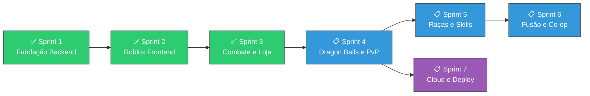
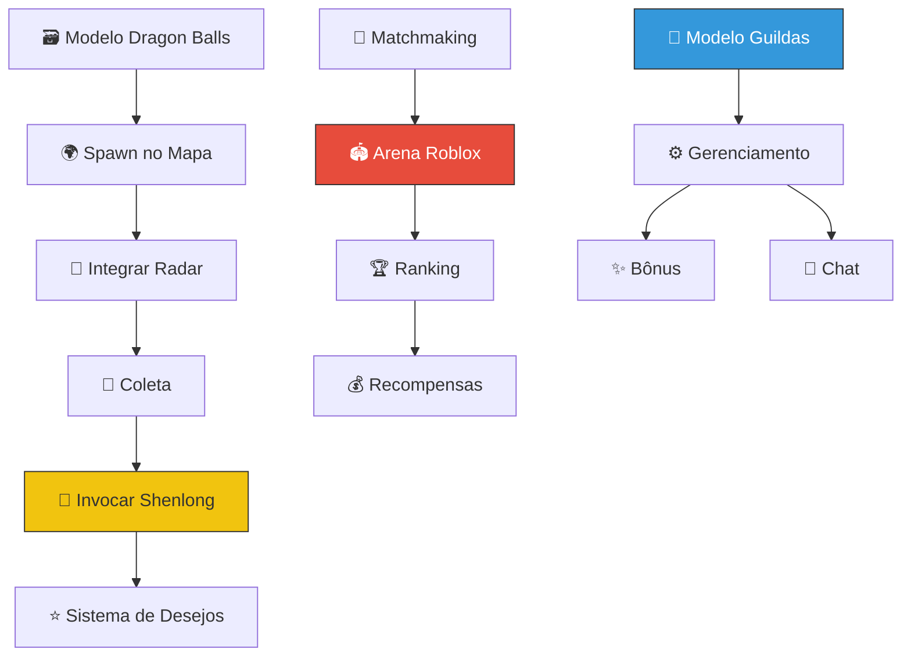
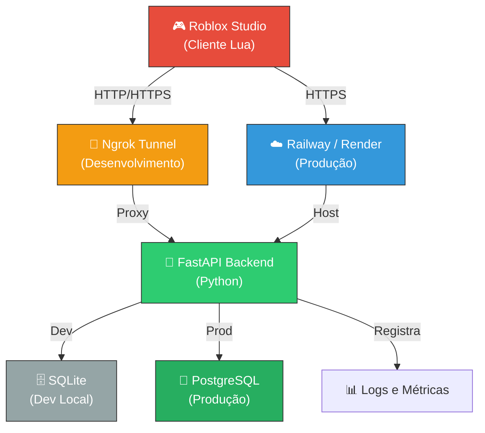
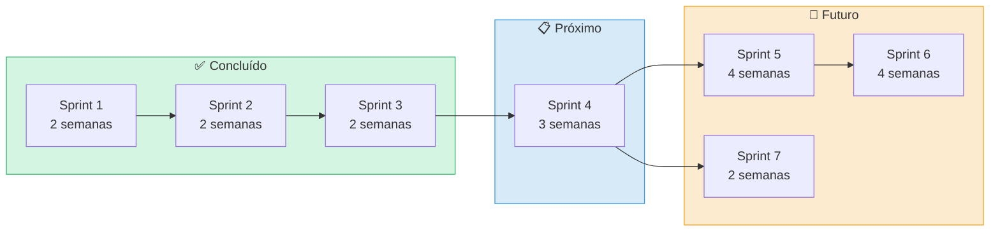

# 🗺️ Roadmap e Sprints de Desenvolvimento

> [!IMPORTANT]
> Este documento contém o planejamento completo de desenvolvimento do projeto Dragon Ball Roblox + Python. Cada sprint é detalhado com suas tarefas, status e dependências. Atualize os checkboxes conforme as tarefas forem concluídas.

---

## 📊 Visão Geral dos Sprints

---

## ✅ Sprint 1 — Fundação do Backend (CONCLUÍDO)

**Objetivo:** Construir a base sólida do backend Python com modelos, banco de dados e engine de jogo.

**Duração:** 2 semanas

### Tarefas

- [x] Configurar estrutura do projeto Python
- [x] Criar modelos de dados (Player, Character, Stats)
- [x] Implementar banco de dados SQLite com SQLAlchemy
- [x] Criar engine de combate básico
- [x] Implementar sistema de XP e level up
- [x] Criar sistema de atributos (ataque, defesa, ki, velocidade)
- [x] Configurar servidor Flask/FastAPI para API REST
- [x] Implementar endpoints básicos (criar personagem, consultar stats)
- [x] Escrever testes unitários para modelos e engine
- [x] Documentar API com Swagger/OpenAPI

### Entregáveis

| Entregável | Status | Arquivo |
|-----------|--------|---------|
| Modelos de dados | ✅ Completo | `backend/models/` |
| Engine de combate | ✅ Completo | `backend/engine/` |
| API REST | ✅ Completo | `backend/api/` |
| Banco de dados | ✅ Completo | `backend/database/` |
| Testes | ✅ Completo | `tests/` |

> [!NOTE]
> O Sprint 1 estabeleceu a arquitetura fundamental. Detalhes técnicos em [[02_Arquitetura_Roblox_Python]].

---

## ✅ Sprint 2 — Frontend Roblox Studio (CONCLUÍDO)

**Objetivo:** Criar os scripts Lua para Roblox Studio, incluindo HUD, controles do jogador, VFX de transformações e comunicação com o backend.

**Duração:** 2 semanas

### Tarefas

- [x] Configurar projeto no Roblox Studio
- [x] Criar sistema de HUD (barras de HP, Ki, XP)
- [x] Implementar controles do jogador (movimentação, ataque básico)
- [x] Criar VFX para transformações SSJ (aura, cabelo, particles)
- [x] Implementar sistema de câmera de combate
- [x] Criar comunicação HTTP entre Roblox (Lua) e backend (Python)
- [x] Implementar sistema de autenticação de jogador
- [x] Criar mapas iniciais (Arena de Treino, Kame House)
- [x] Implementar sistema de NPCs básicos
- [x] Testar integração Roblox ↔ Python

### Entregáveis

| Entregável | Status | Arquivo |
|-----------|--------|---------|
| Scripts de HUD | ✅ Completo | `roblox_scripts/HUD/` |
| Controles do jogador | ✅ Completo | `roblox_scripts/PlayerController/` |
| VFX de transformações | ✅ Completo | `roblox_scripts/VFX/` |
| Comunicação HTTP | ✅ Completo | `roblox_scripts/HttpService/` |

> [!NOTE]
> Para tutorial detalhado de configuração do Roblox Studio, consulte [[07_Tutorial_Roblox_Studio_Passo_a_Passo]].

---

## ✅ Sprint 3 — Combate, Loja e Expansão (CONCLUÍDO)

**Objetivo:** Implementar o sistema completo de habilidades de combate, loja/inventário, testes abrangentes e expandir as notas do Obsidian.

**Duração:** 2 semanas

### Tarefas

- [x] Implementar 17 habilidades de combate (4 físicas, 7 energia, 3 divinas, 3 utilidade)
- [x] Criar sistema de cooldown e custo de Ki
- [x] Implementar fórmula de dano com multiplicadores
- [x] Criar sistema de loja com 20+ itens
- [x] Implementar sistema de inventário (slots, stacking, equipamento)
- [x] Criar endpoints de API para loja e inventário
- [x] Implementar efeitos de equipamentos nos atributos
- [x] Escrever testes para sistema de combate
- [x] Escrever testes para sistema de loja/inventário
- [x] Criar notas Obsidian: Golpes, Loja, Balanceamento, Roadmap

### Entregáveis

| Entregável | Status | Arquivo |
|-----------|--------|---------|
| Sistema de habilidades | ✅ Completo | `backend/skills/` |
| Sistema de loja | ✅ Completo | `backend/shop/` |
| Sistema de inventário | ✅ Completo | `backend/inventory/` |
| Testes expandidos | ✅ Completo | `tests/` |
| Notas Obsidian 08–11 | ✅ Completo | `cerebro_obsidian/` |

> [!TIP]
> Detalhes completos das habilidades em [[08_Sistema_de_Golpes_e_Habilidades]] e dos itens em [[09_Sistema_de_Loja_e_Inventario]].

---

## 📋 Sprint 4 — Dragon Balls, PvP e Guildas (PLANEJADO)

**Objetivo:** Implementar o sistema de busca de Dragon Balls, arena PvP competitiva e sistema de guildas.

**Duração estimada:** 3 semanas

### Tarefas

- [ ] **Sistema de Dragon Balls**
  - [ ] Criar modelo de dados para as 7 Dragon Balls
  - [ ] Implementar spawn aleatório de esferas no mapa
  - [ ] Criar lógica de coleta e rastreamento via Radar do Dragão
  - [ ] Implementar invocação de Shenlong ao reunir as 7 esferas
  - [ ] Criar sistema de desejos (XP boost, Zeni, revive, item raro)
  - [ ] Implementar cooldown de 24h reais após uso das Dragon Balls
  - [ ] Criar VFX épico para invocação de Shenlong no Roblox

- [ ] **Arena PvP**
  - [ ] Criar sistema de matchmaking por power level
  - [ ] Implementar ranking/leaderboard
  - [ ] Criar arena dedicada no Roblox Studio
  - [ ] Implementar sistema de recompensas PvP (Zeni, pontos de ranking)
  - [ ] Balancear habilidades para PvP (ajustar cooldowns/danos)
  - [ ] Criar sistema anti-cheat básico

- [ ] **Sistema de Guildas**
  - [ ] Criar modelo de dados para guildas
  - [ ] Implementar criação, convite e gerenciamento de guildas
  - [ ] Criar bônus de guilda (XP compartilhado, buff de grupo)
  - [ ] Implementar chat de guilda
  - [ ] Criar ranking de guildas

### Dependências

> [!IMPORTANT]
> O item [[09_Sistema_de_Loja_e_Inventario#radar-do-dragão|Radar do Dragão]] será integrado neste sprint. Jogadores que já compraram o item terão acesso imediato ao sistema de busca.

---

## 📋 Sprint 5 — Múltiplas Raças (PLANEJADO)

**Objetivo:** Expandir o jogo com raças jogáveis além dos Saiyans, cada uma com habilidades e transformações únicas.

**Duração estimada:** 4 semanas

### Tarefas

- [ ] **Raça Namekuseijin (Namekian)**
  - [ ] Criar modelo de dados para raça Namekuseijin
  - [ ] Implementar habilidade racial: Regeneração (+5% HP por turno)
  - [ ] Implementar transformação: Namekuseijin Gigante (aumento de tamanho e poder)
  - [ ] Criar skill exclusiva: Braço Elástico (alcance melee +100%)
  - [ ] Criar skill exclusiva: Explosão de Energia Namekuseijin
  - [ ] Implementar fusão Namekuseijin (absorção de poder)

- [ ] **Raça Freeza (Frost Demons)**
  - [ ] Criar modelo de dados para raça Freeza
  - [ ] Implementar formas de Freeza (1ª Forma → 2ª → 3ª → Final → Golden)
  - [ ] Criar skill exclusiva: Death Beam (feixe rápido e preciso)
  - [ ] Criar skill exclusiva: Death Ball (esfera de destruição massiva)
  - [ ] Criar skill exclusiva: Supernova (ultimate devastador)
  - [ ] Implementar habilidade racial: Sobrevivência Extrema (resistir a golpe fatal com 1 HP, uma vez)

- [ ] **Raça Majin**
  - [ ] Criar modelo de dados para raça Majin
  - [ ] Implementar habilidade racial: Absorção (copiar 1 skill do oponente)
  - [ ] Implementar transformações: Majin Base → Majin Puro → Kid Buu Form
  - [ ] Criar skill exclusiva: Candy Beam (transforma inimigo em doce por 2s, stun)
  - [ ] Criar skill exclusiva: Fissão (criar clone com 30% dos stats)
  - [ ] Implementar regeneração passiva única dos Majins

- [ ] **Raça Androide (Android)**
  - [ ] Criar modelo de dados para raça Androide
  - [ ] Implementar habilidade racial: Energia Infinita (Ki não diminui, sem Ki skills com custo)
  - [ ] Implementar upgrade: Absorção de Energia (drena Ki do inimigo)
  - [ ] Criar skill exclusiva: Barreira de Androide (absorve dano e converte em ataque)
  - [ ] Criar skill exclusiva: Hell Flash (ataque de energia devastador)
  - [ ] Implementar customização visual de partes mecânicas

### Comparativo de Raças

| Raça | Vantagem Principal | Desvantagem | Transformação Máxima |
|------|-------------------|-------------|---------------------|
| Saiyan | Zenkai Boost (+poder após derrota) | Ki limitado | Ultra Instinct Dominado |
| Namekuseijin | Regeneração passiva | Ataque menor | Namekuseijin Gigante |
| Raça Freeza | Formas múltiplas, alta versatilidade | Defesa baixa nas formas iniciais | Golden Form |
| Majin | Absorção de skills | Velocidade menor | Kid Buu Form |
| Androide | Energia Infinita (sem custo Ki) | Não recebe Zenkai/buffs orgânicos | Super Androide 17 |

---

## 📋 Sprint 6 — Fusão e Co-op (PLANEJADO)

**Objetivo:** Implementar o sistema de fusão entre jogadores, quests cooperativas e o Torneio Mundial de Artes Marciais.

**Duração estimada:** 4 semanas

### Tarefas

- [ ] **Sistema de Fusão**
  - [ ] Implementar Fusão Metamoru (Dança da Fusão)
    - [ ] Requer 2 jogadores com power level similar (diferença máxima 20%)
    - [ ] Duração: 5 minutos (tempo real)
    - [ ] Power level do fusionado = soma dos dois + 50% bônus
    - [ ] Criar modelo de personagem fundido (Gotenks-style)
    - [ ] Implementar skills exclusivas da fusão
  - [ ] Implementar Fusão Potara (Brincos Potara)
    - [ ] Requer item Brincos Potara de ambos os jogadores
    - [ ] Duração: 10 minutos (tempo real)
    - [ ] Power level = soma dos dois + 100% bônus (mais forte que Metamoru)
    - [ ] Criar modelo de personagem fundido (Vegito-style)
    - [ ] Implementar skills exclusivas Potara (Final Kamehameha, Spirit Sword)
  - [ ] Criar VFX épico para cutscene de fusão

- [ ] **Quests Cooperativas**
  - [ ] Criar sistema de party (grupo de 2–4 jogadores)
  - [ ] Implementar 5 quests co-op iniciais
    - [ ] Invasão Saiyan (derrotar Nappa e Vegeta em equipe)
    - [ ] Resgate em Namek (salvar aldeias Namekuseijins)
    - [ ] Torneio de Cell (enfrentar Cell Jr. em grupo)
    - [ ] Caça aos Androides (encontrar e derrotar A-17 e A-18)
    - [ ] Batalha contra Majin Buu (boss raid épico)
  - [ ] Implementar loot compartilhado e XP de grupo
  - [ ] Criar sistema de revive em co-op

- [ ] **Torneio Mundial de Artes Marciais**
  - [ ] Criar arena do Tenkaichi Budokai no Roblox Studio
  - [ ] Implementar bracket de eliminatória (8, 16 ou 32 jogadores)
  - [ ] Criar sistema de inscrição e timer de torneio
  - [ ] Implementar recompensas exclusivas do torneio
  - [ ] Criar ranking histórico de campeões
  - [ ] Implementar modo espectador para jogadores eliminados

---

## 📋 Sprint 7 — Cloud e Deploy (PLANEJADO)

**Objetivo:** Preparar o projeto para deploy em produção com banco de dados persistente, hosting na nuvem e ferramentas de monitoramento.

**Duração estimada:** 2 semanas

### Tarefas

- [ ] **Migração de Banco de Dados**
  - [ ] Migrar de SQLite para PostgreSQL
  - [ ] Criar scripts de migração com Alembic
  - [ ] Configurar conexão segura com variáveis de ambiente
  - [ ] Implementar backup automático diário
  - [ ] Testar integridade de dados após migração

- [ ] **Deploy na Nuvem**
  - [ ] Avaliar plataformas: Railway vs Render vs Fly.io
  - [ ] Configurar Dockerfile para o backend
  - [ ] Criar arquivo `railway.json` ou `render.yaml`
  - [ ] Configurar variáveis de ambiente de produção
  - [ ] Deploy do backend na plataforma escolhida
  - [ ] Configurar domínio customizado (opcional)

- [ ] **Ngrok para Testes**
  - [ ] Configurar Ngrok para expor servidor local
  - [ ] Criar script de automação para iniciar Ngrok + servidor
  - [ ] Documentar processo de teste com Roblox Studio via Ngrok
  - [ ] Configurar HTTPS para segurança

- [ ] **Monitoramento e Logs**
  - [ ] Implementar logging estruturado (JSON logs)
  - [ ] Configurar health check endpoint
  - [ ] Implementar métricas básicas (requests/sec, latência, erros)
  - [ ] Criar dashboard de monitoramento simples
  - [ ] Configurar alertas para erros críticos

### Arquitetura de Deploy

> [!WARNING]
> Antes do deploy em produção, certifique-se de que **todas as credenciais e secrets** estão em variáveis de ambiente e **NÃO hardcoded** no código. Revise [[02_Arquitetura_Roblox_Python]] para a estrutura de configuração.

---

## 📅 Linha do Tempo Estimada

**Tempo total estimado:** ~19 semanas (incluindo os 6 já concluídos)

---

## 📝 Notas de Planejamento

> [!TIP]
> **Priorização:** O Sprint 7 (Cloud/Deploy) pode ser iniciado em paralelo com o Sprint 4, pois não possui dependências de gameplay. Isso permite testes de integração mais cedo.

> [!NOTE]
> **Metodologia:** Usamos sprints ágeis de 2–4 semanas com revisões ao final de cada sprint. As tarefas podem ser ajustadas conforme feedback de playtest e prioridades do projeto.

### Critérios de Aceitação por Sprint

| Sprint | Critério de "Pronto" |
|--------|---------------------|
| Sprint 4 | Dragon Balls coletáveis, PvP funcional, guildas criáveis |
| Sprint 5 | 4 raças jogáveis com skills únicas e transformações |
| Sprint 6 | Fusão funcional entre 2 jogadores, 5 quests co-op jogáveis, torneio completo |
| Sprint 7 | Backend rodando na nuvem com PostgreSQL, Ngrok funcional para dev |

---

## 🔗 Links Relacionados

- [[00_DASHBOARD_CEREBRO]] — Painel central do projeto
- [[01_GDD_Dragon_Ball_Roblox]] — Game Design Document
- [[02_Arquitetura_Roblox_Python]] — Arquitetura técnica
- [[03_Catalogo_Transformacoes]] — Transformações (base para Sprint 5)
- [[05_Sistema_de_Sagas_e_Missoes]] — Missões (base para co-op Sprint 6)
- [[06_Ideias_Futuras_e_Expansao]] — Ideias que alimentam os sprints futuros
- [[08_Sistema_de_Golpes_e_Habilidades]] — Habilidades (expandidas no Sprint 5)
- [[09_Sistema_de_Loja_e_Inventario]] — Loja (Radar do Dragão para Sprint 4)
- [[10_Balanceamento_e_Economia]] — Balanceamento geral
