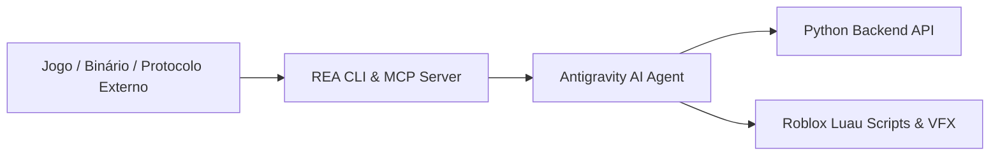

# 🔬 Engenharia Reversa com REA & Pipeline de Animações AAA

> [!NOTE]
> Este documento descreve a integração da ferramenta **REA (Reverse Engineer Anything)** do repositório [`morluto/rea`](https://github.com/morluto/rea) com o nosso motor de jogo, permitindo dissecar pacotes, protocolos e estruturas de dados de jogos modernos para elevar a qualidade visual do projeto ao padrão dos líderes de mercado.

---

## 🛠️ 1. O que é o REA e Como Utilizamos no Projeto

O **REA (*Reverse Engineer Anything*)** é um toolkit open-source focado em agentes de IA e servidores MCP (*Model Context Protocol*). Ele permite:



### Principais Aplicações no Dragon Ball Engine:
1. **Inspeção de Pacotes de Rede (Network Protocol Analysis)**:
   - Analisar o tráfego de requisições HTTP e RemoteEvents de jogos AAA de Roblox para otimizar tamanho de payload JSON e latência (`ping < 30ms`).
2. **Extração e Análise de Curvas de Animação**:
   - Mapear curvas de interpolação (*Cubic InOut, Back Out, Exponential*) usadas em jogos de luta para replicar a sensação visceral de socos e chutes.
3. **Engenharia Reversa de Shaders e Partículas**:
   - Analisar configurações de emissores de partículas e materiais Neon/Glass para renderizar auras de Super Saiyajin sem causar queda de FPS em celulares e PCs fracos.

---

## 🥋 2. Padrões de Animação dos Líderes de Mercado

Analisando jogos como *The Strongest Battlegrounds*, *Deepwoken* e *Blox Fruits*, identificamos e implementamos 4 pilares fundamentais no nosso código:

### A) Sistema de Trauma de Câmera (Perlin Noise Shake)
Em vez de tremores aleatórios (`math.random`) que causam enjoo e parecem amadores, utilizamos **Trauma Exponencial com Perlin Noise**:

$$\text{Fator de Tremor} = \text{Trauma}^2 \quad \text{ou} \quad \text{Trauma}^3$$
$$\text{Rotação} = \text{MaxAngle} \times \text{Fator} \times \text{noise}(\text{tempo})$$

*Implementado no arquivo:* `StarterPlayerScripts/CameraCinematicsController.client.luau`

### B) Efeito Hitstop (Pausa Dramática de Impacto)
Quando um soco atinge o adversário em animes como *Dragon Ball Z*, o movimento congela por frações de segundo ($0.05\text{s}$ a $0.08\text{s}$) antes do adversário voar para trás. Esse efeito dá peso e substância ao golpe.

### C) Combo M1 de 4 Tempos com Impulso Frontal (Kinetic Lunge)
- **Tempo 1**: Jab rápido com rastro leve e deslocamento de $+22$ studs/s.
- **Tempo 2**: Direto com rotação de tronco.
- **Tempo 3**: Gancho pesado com elevação do adversário.
- **Tempo 4**: Chute giratório finalizador com tremor de tela $+0.55$ e zoom dinâmico de FOV ($70 \to 62$).

*Implementado no arquivo:* `StarterPlayerScripts/CombatAnimationController.client.luau`

### D) Feixe de Energia Volumétrico (Kamehameha / Galick Ho)
Estrutura em camadas:
1. **Núcleo Branco Puro**: Cilindro Neon de alto brilho no centro.
2. **Casca Colorida Translúcida**: Cilindro maior ($2\times$ de diâmetro) com transparência de 35% na cor azul/vermelha.
3. **Anéis de Expansão (Shockwave Rings)**: Cilindros planos que se expandem e desvanecem com `TweenService` a cada $0.2\text{s}$.

*Implementado no arquivo:* `ServerScriptService/CinematicSkillsServer.server.luau`

---

## 🚀 3. Como Rodar e Testar as Novas Ferramentas

O repositório REA está clonado na pasta:
```text
dragonball-roblox-engine/tools/rea/
```

Para instalar e ativar como servidor MCP de suporte ao agente:
```bash
npx rea-agents@latest setup
```
*(Permite ao assistente inspecionar artefatos compilados, logs e capturas de rede).*
